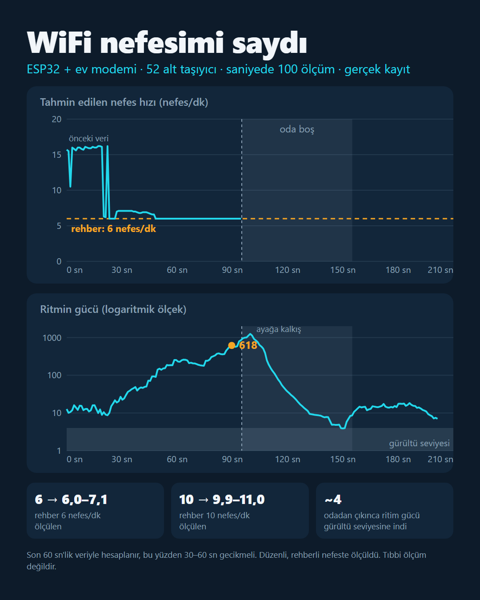

# WiFi ile Varlık, Nefes ve Konum Algılama

**English:** [summary below](#english). Lisans: MIT.

Evdeki modem ve WiFi sinyaliyle odada biri var mı, hareket ediyor mu, nefes ritmi ne, odanın neresinde duruyor diye ölçme denemeleri. Önce laptopun WiFi sinyal gücüyle (RSSI), sonra bir ESP32'nin okuduğu kanal bilgisiyle (CSI).

## Sonuçlar

- **Laptop RSSI:** Laptop ile modem arasına girince sinyal −43'ten −50 dBm'e düştü. Windows değeri ~5 sn'de bir yenilediği için hızlı geçişler kaçıyor.
- **ESP32 CSI:** Saniyede 100 ölçüm, her ölçümde 52 alt taşıyıcı. Alıcının otomatik kazanç ayarı (AGC) her paketi ölçeklediği için her paket kendi ortalamasına bölünüyor. Hareketsizken hareket skoru ~4–6, hareketliyken 12–29.
- **Nefes:** Rehber 10 nefes/dk → ölçülen 9,9–11,0. Rehber 6 nefes/dk → ölçülen 6,0–7,1. Odadan çıkınca ritmin gücü gürültü seviyesine indi. 60 sn pencere, 30–60 sn gecikme. Tıbbi bir ölçüm değildir.
- **Oda içi konum:** 4 noktanın "parmak izi" öğretildi (k-en yakın komşu). Her kaydın ilk yarısıyla öğrenilip ikinci yarısıyla sınandığında %80 doğru (şans %25). Orta %100, Sol orta %93, Orta ön %80, Sağ arka %47.

## Klasörler

| Klasör | İçerik |
|---|---|
| `rssi-monitor/` | Laptopun WiFi sinyal gücünü (RSSI) canlı çizen sayfa. `node rssi-monitor/server.js` → http://localhost:8765 (ağ adını ve modem MAC adresini hiç okumaz) |
| `esp32-csi/csi_recv/` | ESP32 programı. Modeme bağlanır, saniyede 100 ping atar, her cevabın CSI verisini USB'den gönderir |
| `esp32-csi/viewer/` | Canlı CSI izleyici: şelale ısı haritası, hareket skoru, nefes hızı, rehberli nefes, oda haritası. `node esp32-csi/viewer/server.js` → Chrome'da http://localhost:8766 |
| `ses-sonari/` | Laptop hoparlörü ve mikrofonuyla deneysel ses sonarı (yarım kaldı). `node ses-sonari/server.js` → http://localhost:8767 |
| `rssi-nasil-calisir.html` | RSSI'ı anlatan etkileşimli sayfa |
| `linkedin/`, `linkedin-2/`, `linkedin-3/`, `linkedin-esp32/` | LinkedIn gönderileri: görseller, videolar, metinler |
| `linkedin-video/` | 1. bölümün canlandırma videosunun (Remotion) kaynak kodu |

## Kurulum

1. [Arduino CLI](https://arduino.github.io/arduino-cli/) ve ESP32 kart paketini kur:
   ```
   arduino-cli config add board_manager.additional_urls https://espressif.github.io/arduino-esp32/package_esp32_index.json
   arduino-cli core install esp32:esp32
   ```
2. `esp32-csi/csi_recv/secrets.example.h` dosyasını `secrets.h` adıyla kopyala ve doldur: ağ adı, şifre, modemin 2,4 GHz BSSID'si ve kanalı. BSSID ve kanalı Windows'ta şu komutla bulabilirsin:
   ```
   netsh wlan show networks mode=bssid
   ```
3. Derle ve yükle (port numarası sende farklı olabilir):
   ```
   arduino-cli compile --fqbn esp32:esp32:esp32 esp32-csi/csi_recv
   arduino-cli upload --fqbn esp32:esp32:esp32 -p COM6 esp32-csi/csi_recv
   ```
   Kart bağlanmazsa: Boot'a basılı tut, EN'e bas, Boot'u bırak. Bilgisayarın kendi USB girişini kullan.
4. `node esp32-csi/viewer/server.js` çalıştır, Chrome'da http://localhost:8766 adresini aç ve "ESP32'ye bağlan"a bas.

## Gizlilik

Bu depoda **yok**: WiFi şifresi, ağ adı, modemin MAC adresi (bir MAC adresi evin konumunu ele verebilir), derlenmiş program, ham ölçüm kayıtları (nefes, konum, sinyal), ham ekran kayıtları ve ekran görüntüleri. Hepsi `.gitignore` ile dışarıda tutuluyor. Depodaki videolar LinkedIn için hazırlanmış hâlleri; ağ adı gizlenmiş ve ses içermiyorlar.

Yerel sunucular (`server.js`) sadece bu bilgisayardan erişilebilir (`127.0.0.1`), başka sitelerden gelen yazma isteklerini reddeder ve modemin MAC adresini okumaz. Bu yüzden `linkedin-2/build-chart.js` ve `linkedin-3/build-map.js` kendi ölçüm verin olmadan çalışmaz; görsellerin kendisi depoda.

WiFi ile algılama sadece kendi evinde ve evde yaşayanların bilgisiyle yapılmalı.

## Lisans

MIT, bkz. [LICENSE](LICENSE).

---

## English

**Sensing presence, breathing and position in a room from home WiFi**: first with a laptop's signal strength (RSSI), then with channel state information (CSI) from an ESP32 that pings the home router 100 times a second.

### Results
These come from one person in one room, sitting still, with a paced-breathing guide. They are hobby measurements, not medical ones.

- **Laptop RSSI:** stepping between the laptop and the router dropped the signal from −43 to −50 dBm. Windows only refreshes RSSI about every 5 s, so quick movements are missed.
- **ESP32 CSI:** 100 packets/s, 52 data subcarriers each. The receiver's automatic gain control rescales whole packets, so each packet is divided by its own mean, leaving only the shape across subcarriers. Motion score (summed per-subcarrier std over the summed means, ×100, 0.5 s windows): about 4–6 when still, 12–29 when moving.
- **Breathing:** packets are averaged to 10 Hz and the last 60 s are kept for each subcarrier. Each subcarrier is detrended, Hann-windowed and transformed over 0.1–0.7 Hz; the 8 most periodic subcarriers are summed, and the peak, with parabolic interpolation, gives the rate. A 10 breaths/min guide measured 9.9–11.0, and a 6/min guide 6.0–7.1. When I left the room, the rhythm's power fell to the noise floor. Expect a 30–60 s lag.
- **Position:** a k-nearest-neighbour vote over averaged CSI vectors, trained on 4 spots for 15 s each. Trained on the first half of each recording and tested on the second, it was right 80% of the time (chance is 25%): centre 100%, centre-left 93%, centre-front 80%, back-right 47%. It has to be retrained when furniture moves.



### Running it
1. Install [Arduino CLI](https://arduino.github.io/arduino-cli/) and the ESP32 core (commands above).
2. Copy `esp32-csi/csi_recv/secrets.example.h` to `secrets.h` and fill in your 2.4 GHz network name, password, the router's 2.4 GHz BSSID and channel (`netsh wlan show networks mode=bssid` on Windows). `secrets.h` is git-ignored.
3. `arduino-cli compile --fqbn esp32:esp32:esp32 esp32-csi/csi_recv`, then `arduino-cli upload ... -p <your port>`.
4. `node esp32-csi/viewer/server.js`, open http://localhost:8766 in Chrome (it uses Web Serial), and press "ESP32'ye bağlan" (connect).

The viewer UI and most comments are in Turkish; the code comments in the ESP32 sketch and the viewer's signal processing are in English. `rssi-monitor/` is the laptop RSSI page, and `ses-sonari/` is an unfinished speaker-and-microphone sonar.

### Privacy
The repo contains no WiFi password, network name, router MAC address (a BSSID can be looked up in public WiFi maps to locate a home), compiled firmware or raw measurements. The local servers bind to 127.0.0.1 and never read the router's MAC address. Please only sense people in your own home, with their knowledge.
